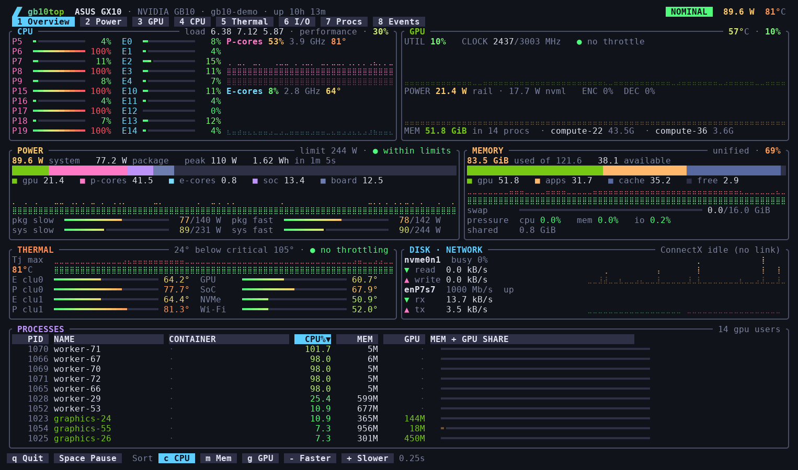
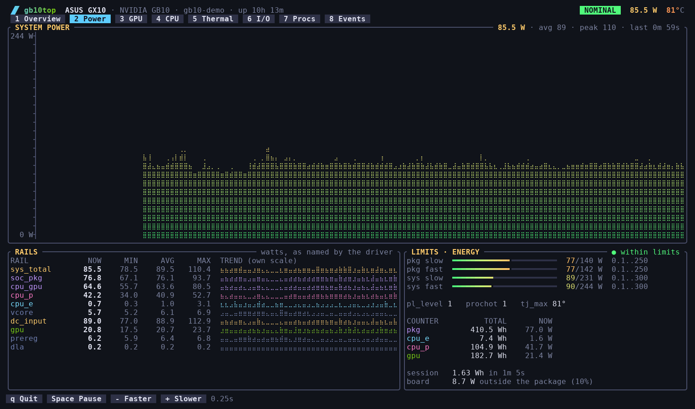
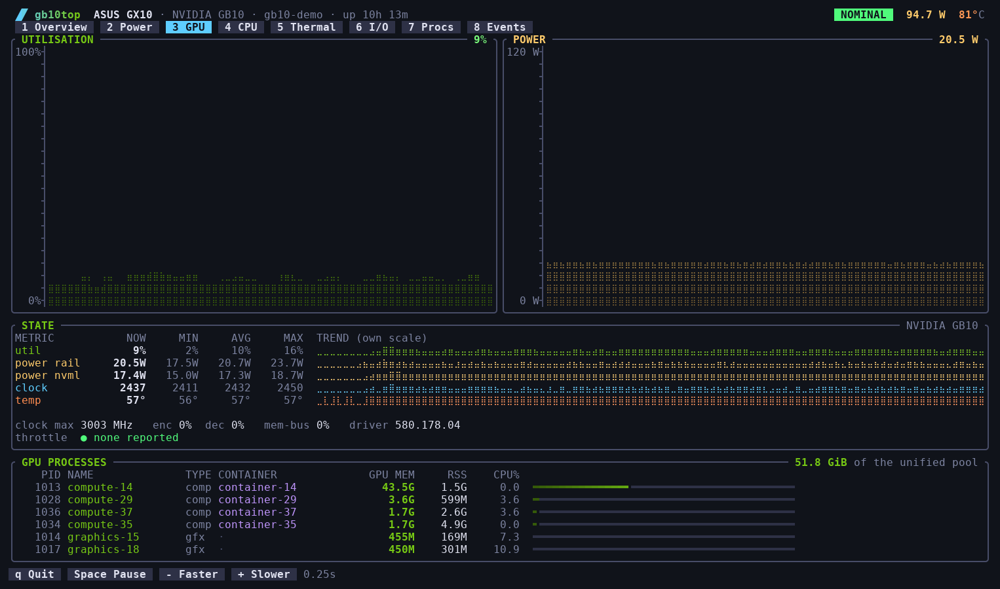
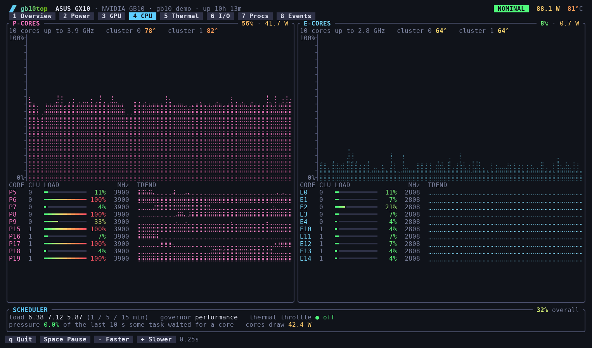
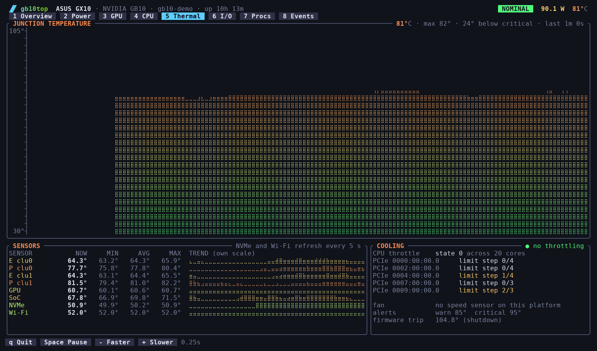
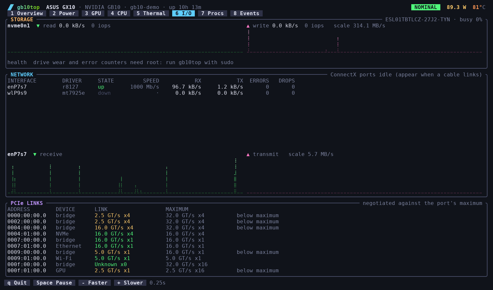
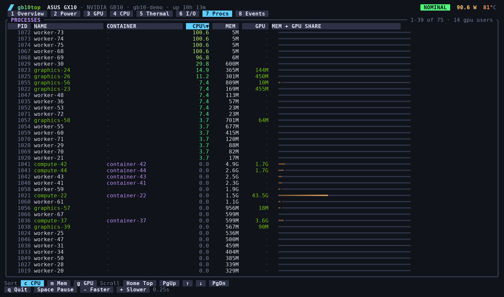
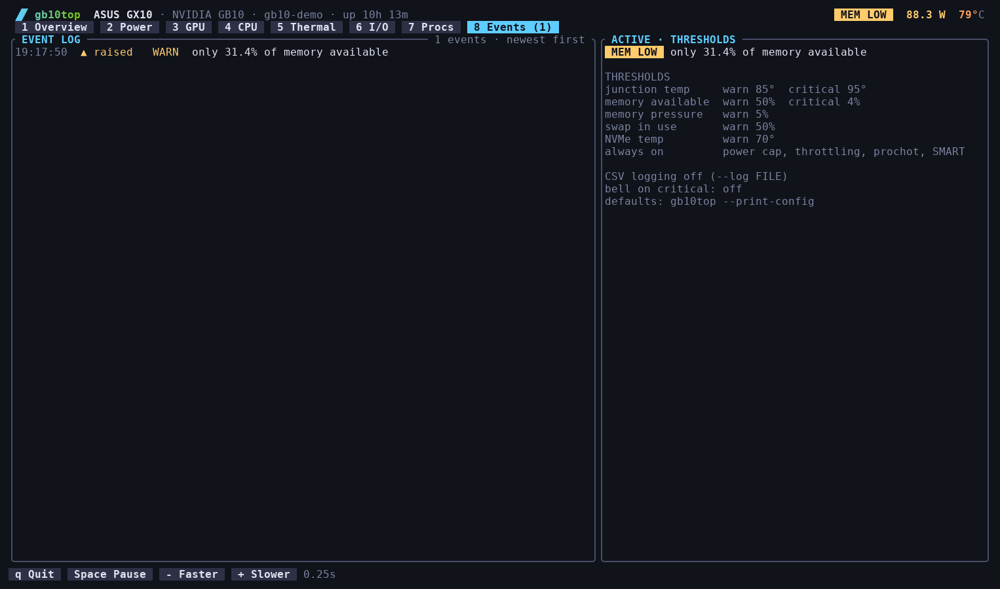

# gb10top

A terminal dashboard for NVIDIA GB10 machines: the ASUS Ascent GX10, the DGX
Spark and their siblings. It shows what generic monitors miss on this
platform: whole-system power split by rail, the firmware power limits and when
they bite, unified memory split between GPU and applications, and named
temperatures for each core cluster.

Developed and measured on an ASUS Ascent GX10 (Ubuntu 24.04, kernel
7.0-nvidia, driver 580).

## Screenshots

Click any tab below to open its full-size screenshot. These captures use live
GX10 readings with anonymized host, process and container identifiers. The
Events example uses a custom 50% available-memory warning threshold.

| Overview | Power |
|---|---|
| [](docs/screenshots/overview.png) | [](docs/screenshots/power.png) |

| GPU | CPU |
|---|---|
| [](docs/screenshots/gpu.png) | [](docs/screenshots/cpu.png) |

| Thermal | I/O |
|---|---|
| [](docs/screenshots/thermal.png) | [](docs/screenshots/io.png) |

| Procs | Events |
|---|---|
| [](docs/screenshots/procs.png) | [](docs/screenshots/events.png) |

## Install

Build on Linux with a Rust toolchain ([rustup](https://rustup.rs)).
GPU telemetry uses NVML from the NVIDIA driver.

```sh
git clone https://github.com/catallo/gb10top.git
cd gb10top
cargo install --locked --path .
```

Cargo installs `gb10top` in `~/.cargo/bin` by default. With that directory
on your `PATH`, you can start it from any directory.

Power telemetry comes from the `spbm` hwmon device, which is provided by the
out-of-tree [spark_hwmon](https://github.com/antheas/spark_hwmon) driver.
Without it gb10top still runs; the power panels say the sensor is missing and
GPU power falls back to NVML.

## Use

```
gb10top
```

The full overview needs a terminal of at least 110x31; 150x46 shows
everything. Smaller terminals (down to 60x14) get a compact summary, and the
detail tabs still work.

| Key | Mouse | Action |
|---|---|---|
| `1`-`8`, `Tab`, `←` `→` | Click a tab | Switch tab |
| `c` `m` `g` | Click the CPU, MEM, or GPU column header or footer button | Sort processes by CPU, resident memory, or GPU memory |
| `i` `n` `o` `s` | Click PID, NAME, CONTAINER, or MEM + GPU SHARE | Sort by process ID, name, container, or combined resident and GPU memory |
| `↑` `↓` `PgUp` `PgDn` `Home` | Use the wheel over the list or click **↑**, **↓**, **PgUp**, **PgDn**, or **Top** | Scroll the process list on the Procs tab |
| `space` | Click **Pause** or **Resume** | Toggle sampling |
| `-` `+` | Click **Faster** or **Slower** | Change the refresh interval |
| `q` | Click **Quit** | Quit |

| Tab | Contents |
|---|---|
| Overview | CPU, GPU, power, memory, thermal, disk, network and processes at once |
| Power | system power history, every rail with min / avg / max, firmware limits, energy counters |
| GPU | utilisation and power history, clock, temperature, GPU processes with container names |
| CPU | per-core load, cluster, frequency and trend; cluster temperatures; load and pressure |
| Thermal | junction temperature history, every sensor, cooling states |
| I/O | disk and network history, all interfaces, PCIe link states, drive health |
| Procs | sortable, scrollable list combining the top 40 processes by CPU, the top 40 by resident memory, and all detected GPU processes |
| Events | alert log, active alerts, thresholds |

For NVMe wear, spare and error counters on the I/O tab, install `nvme-cli`
and run `sudo ~/.cargo/bin/gb10top` if you used the default install location.

### Plain output

```
gb10top --once              # one text sample of every sensor
gb10top --json --count 10   # ten samples as JSON lines
gb10top --log power.csv     # dashboard, plus one CSV row per sample
```

`--log` also works with `--once` and `--count`. `gb10top --help` lists every
option.

## Configuration

The optional config file is `~/.config/gb10top/config.toml`, or
`$XDG_CONFIG_HOME/gb10top/config.toml` when `XDG_CONFIG_HOME` is set.
Use `--config FILE` to select a different file.
`gb10top --print-config` prints the defaults with comments:

```toml
interval = 1.0
history = 1200
# log = "/var/tmp/gb10top.csv"
bell = false

[alerts]
tj_warn_c = 85.0
tj_crit_c = 95.0
mem_available_warn_pct = 10.0
mem_available_crit_pct = 4.0
mem_pressure_warn_pct = 5.0
swap_used_warn_pct = 50.0
disk_temp_warn_c = 70.0
```

Alerts that need no threshold are always on: package power cap, GPU or CPU
throttling, a change in the `prochot` signal, and a SMART critical warning.

## What the numbers mean

Measured on the GX10 by loading P cores, E cores and the GPU separately:

- **System power** (`sys_total`, matching `dc_input` within about 1 W) is the
  whole machine. **Package** (`soc_pkg`) is the SoC. The difference is the rest
  of the board plus conversion loss.
- **Firmware limits**: `pkg fast` (pl2) tracks instantaneous package power and
  `pkg slow` (pl1) a slow average of it; `sys fast` and `sys slow` are the same
  pair for system power. When package power passes the fast limit the firmware
  holds it there and the `POWER CAP` alert is raised. NVML reports no throttle
  reason when this happens, although the GPU clock drops.
- **GPU power** is the board's GPU rail, which reads 15-20% above NVML's figure
  and reacts faster. NVML's value is shown alongside it.
- **Memory** is one unified pool. NVML cannot report GPU memory totals on this
  platform, so GPU memory is the sum of per-process allocations. Those are not
  part of a process's resident memory, so the process table's share bar adds
  the two.
- **Temperatures**: the seven anonymous ACPI thermal zones are, in order,
  hottest junction, E cluster 0, P cluster 0, E cluster 1, P cluster 1, GPU and
  SoC. Cluster 0 is cores 0-9 and cluster 1 is cores 10-19.
- **ConnectX ports** are powered down until a cable links, so they are absent
  from the interface list and PCI bus when idle.
- There is no fan speed sensor on this platform.

The full sensor notes are in the header of `src/collect/spbm.rs`.

## Development

```
cargo test
```

The tests run against a recorded copy of the GX10's `/proc` and `/sys` files in
`tests/fixtures/gx10`. To re-record it, or record another machine:

```
tools/record_fixture.py tests/fixtures/NAME
gb10top --root tests/fixtures/NAME --once
```

The recorder keeps hardware state only: no MAC addresses, a placeholder host
name, physical network interfaces only, and two made-up processes.

To check a layout without a terminal, draw one frame as plain text:

```
gb10top --render 150x46 --tab power
```
